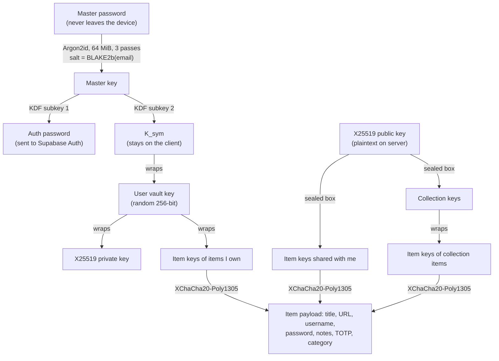

# Secure Vault: Zero-Knowledge Team Password Manager

A zero-knowledge password manager with a **web app** (React) and a **Chrome extension** (Manifest V3), backed by Supabase. Passwords are encrypted in the browser before anything is sent. The server stores only ciphertext and who-can-access-what.

| | |
|---|---|
| **Web app** | Vault CRUD, real-time search, categories, Bitwarden / 1Password / Chrome import, CSV/JSON export, direct sharing with Viewer / Editor / Admin roles, team collections, TOTP, password generator, auto-lock |
| **Extension** | Login detection, "Save?" / "Update password?" prompts, domain-matched inline autofill (including shared items), popup quick search (Ctrl/⌘+Shift+L), quick-copy username / password / TOTP, auto-lock with master password or PIN |
| **Backend** | Postgres + Row Level Security that enforces the permission matrix server-side |

```
apps/web/          React 19 + Vite + Tailwind SPA
apps/extension/    WXT (MV3) – background service worker, content script, popup
packages/core/     Shared TypeScript: crypto, Supabase data layer, importers, domain matching, TOTP
supabase/          SQL migrations: schema, RLS policies, RPCs
```

---

## 1. Security architecture

### Key hierarchy



- **Library:** libsodium (`libsodium-wrappers-sumo`), one audited implementation of Argon2id, XChaCha20-Poly1305 and X25519 sealed boxes. It runs as WebAssembly in the web app and in the extension service worker.
- **Login without revealing the password.** The master key is split into two independent subkeys. One is hex-encoded and used as the Supabase Auth password. The other (`K_sym`) never leaves the client. Supabase only ever sees a derived value, and it can't be turned back into `K_sym` (the same model Bitwarden uses).
- **A random vault key** sits between `K_sym` and the data, so changing the master password only re-wraps that one key.
- **Everything is encrypted**, including titles, URLs and categories. The server can't see which sites you use. It sees row ids, owners, timestamps and access rows.
- **Associated data** binds each ciphertext to its row (`item:<id>`, `item-key:<id>` …), so a malicious server can't swap ciphertexts between items without decryption failing.

### Sharing protocol (PRD §2)

Each credential has its own random **item key**. To share with user B:

1. A decrypts the item key locally.
2. A seals it with **B's public key** (`crypto_box_seal`). The key is looked up by exact email through an RPC, so profiles can't be enumerated.
3. The sealed key is stored as an `item_access` row for B, with a role.
4. B opens it with **B's private key** and decrypts the item.

> **Deviation from the PRD's literal wording:** the PRD says A encrypts *the password* with B's public key. Here A encrypts the *item key* instead. The cryptographic guarantee is identical, and it means an Editor's change is immediately visible to everyone, with no re-encryption per recipient.

**Collections** ("Marketing Team", "Family") have their own random collection key, sealed to every member's public key. Item keys of items in the collection are wrapped with the collection key. Adding a member is one sealed box, however many items the collection holds.

### Permissions: enforced by the database, not just the UI

| Role | View | Auto-fill | Edit | Re-share |
|---|:-:|:-:|:-:|:-:|
| Viewer | ✓ | ✓ | | |
| Editor | ✓ | ✓ | ✓ | |
| Admin / Owner | ✓ | ✓ | ✓ | ✓ |

*View* is enforced cryptographically: no wrapped key means no plaintext. *Edit* and *re-share* are enforced by **Postgres Row Level Security** (`supabase/migrations/*_rls.sql`), so a modified client can't bypass them:

- `item_role(item)` = max(ownership, direct grant, collection membership). Collection owners act as admins on other people's items.
- Only `editor+` can update an item. A trigger blocks ownership transfer and lets only admins move items between collections.
- Only `admin+` can insert, change or delete other people's `item_access` / `collection_members` rows. Nobody can grant `owner`.
- Optimistic concurrency: updates are filtered on `revision`, so a stale write fails instead of silently overwriting someone else's edit.

### Extension security model

- **Keys live only in the background service worker.** Unlocked keys are parked in `chrome.storage.session`, which is memory-only, wiped on browser restart, and restricted to `TRUSTED_CONTEXTS` so content scripts can't read it. That lets the MV3 worker be suspended without locking the vault.
- **Content scripts are untrusted** because they run inside arbitrary pages:
  - They get only `{title, username}` lists for their own frame's domain.
  - A password is released only when the user clicks a fill entry, and only if the item matches `sender.url`, which Chrome supplies. The page can't claim a URL.
  - Popup fills go to the **top frame only**, so a cross-origin iframe never receives credentials for the page that embeds it.
- **Domain matching** uses the Public Suffix List (`tldts`): `app.github.com` matches `github.com`, while `github.com.evil.io` and `alice.github.io` vs `bob.github.io` do **not** match.
- In-page UI lives in a **closed shadow root**, and vault text is inserted with `textContent` only.
- **Auto-lock** after N minutes of inactivity (checked by `chrome.alarms`), and immediately when the OS screen locks (`chrome.idle`).
- **PIN unlock:** the key bundle is encrypted with Argon2id(PIN, random salt). It's kept in session storage only, so a browser restart requires the master password, and it's discarded after 5 wrong attempts.
- Copied passwords are cleared from the clipboard after 30 s (via an offscreen document in the extension).
- The web app doesn't fetch favicons (that would leak your site list to a third party) and ships a strict CSP (`apps/web/vercel.json`).

### Known limitations / trade-offs

- **A Viewer can read the password**, which is inherent to autofill, so they could copy it. Revoking access removes future access, and the UI recommends rotating the password afterwards. Collection keys aren't rotated when a member leaves.
- **Public keys are trusted on first use.** Settings shows a public-key fingerprint for out-of-band verification, but there's no enforced verification step.
- **The KDF salt is derived from the email**, so changing your email would require re-keying. This isn't supported.
- **No account recovery.** A forgotten master password means lost data, by design.
- Login-form heuristics cover standard forms, SPA forms and two-step (username, then password) flows. Exotic custom widgets may not be detected.

---

## 2. Running locally

**Prerequisites:** Node 20+, pnpm 9+, Docker (for local Supabase).

```bash
pnpm install
pnpm db:start                          # starts Supabase in Docker and applies migrations
                                       # prints API URL + anon key

cp apps/web/.env.example apps/web/.env.local                # paste URL + anon key
cp apps/extension/.env.example apps/extension/.env.local    # same values + VITE_WEB_URL

pnpm dev:web                           # http://localhost:5173
pnpm --filter @vault/extension build   # -> apps/extension/.output/chrome-mv3
```

**Load the extension:** open `chrome://extensions`, enable *Developer mode*, click *Load unpacked*, and pick `apps/extension/.output/chrome-mv3`. Create an account in the web app, then log in from the extension popup.

### Tests

```bash
pnpm test        # unit: crypto round-trips, cross-user sharing, RFC 6238 TOTP vectors,
                 #       PSL domain matching, Bitwarden/1Password/Chrome importers

# integration: the full permission matrix against a live (local) Supabase
SUPABASE_URL=http://127.0.0.1:54321 SUPABASE_ANON_KEY=<anon key> \
  pnpm --filter @vault/core test:integration
```

The integration suite creates three real accounts and asserts that the database:
- stores no plaintext;
- denies a viewer's edit and re-share;
- allows an editor's edit (visible to the owner) but blocks their re-share and self-promotion;
- rejects stale writes;
- lets an admin re-share;
- removes access on revoke;
- gives collection members group access by role;
- returns items to their owners when a collection is deleted;
- prevents profile enumeration.

---

## 3. Deploying

1. **Supabase:** create a project at supabase.com, then `npx supabase link --project-ref <ref>` and `npx supabase db push`. Under *Authentication → Providers → Email*, either disable "Confirm email" or keep it on (the app handles the confirmation step). Add your web URL under *URL Configuration*.
2. **Web (Vercel):** import the repo and set the root directory to `apps/web`. `vercel.json` already contains the monorepo build command, SPA rewrites and security headers. Set `VITE_SUPABASE_URL` and `VITE_SUPABASE_ANON_KEY`.
3. **Extension:** put the hosted values in `apps/extension/.env.production`, then run `pnpm --filter @vault/extension zip`. Load the unpacked build or distribute the zip.

---

## 4. PRD coverage

| PRD | Where |
|---|---|
| §2 Argon2id key derivation, master password never sent | `packages/core/src/crypto/kdf.ts`, `api/account.ts` |
| §2 X25519 keypair, private key wrapped by K_sym-derived key | `crypto/keys.ts` |
| §2 Sharing via recipient public key | `crypto/item.ts`, `VaultService.shareItem` |
| §3.1 Title / username / password / URL / category / notes (+ TOTP) | `types.ts`, `apps/web/src/components/ItemEditor.tsx` |
| §3.1 Bitwarden / 1Password / Chrome import, CSV/JSON export | `packages/core/src/import`, `export`, `pages/ImportExportPage.tsx` |
| §3.1 Real-time search by title / domain / category | `pages/VaultPage.tsx` (client-side over decrypted data, virtualised list) |
| §3.2 Share by email, Viewer / Editor / Admin roles | `components/ShareDialog.tsx`, RLS policies |
| §3.2 Team workspaces / collections | `pages/CollectionsPage.tsx`, `collections` + `collection_members` |
| §4.1 Login detection, save prompt, update prompt | `apps/extension/entrypoints/content/index.ts`, `background.ts` (`capture`, `getPrompt`) |
| §4.2 eTLD+1 domain matching | `packages/core/src/domain.ts` |
| §4.2 Inline icon in text / password fields | `lib/forms.ts`, `content/ui.ts` |
| §4.2 Shared items in autofill | the background matches over owned, shared and collection items alike |
| §4.2 Quick copy username / password / TOTP | `entrypoints/popup/App.tsx` |
| §4.3 Ctrl/⌘+Shift+L quick search and fill | `wxt.config.ts` (`_execute_action`), popup keyboard navigation |
| §4.3 Auto-lock, master password or PIN unlock | `background.ts` (alarms, idle, PIN envelope) |
